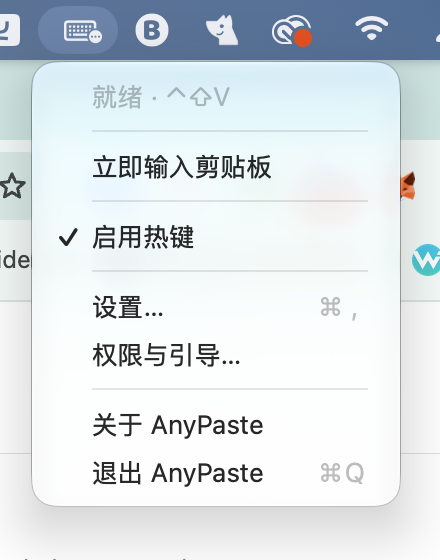
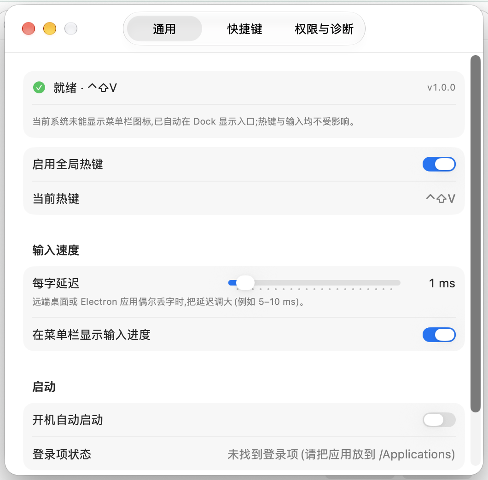
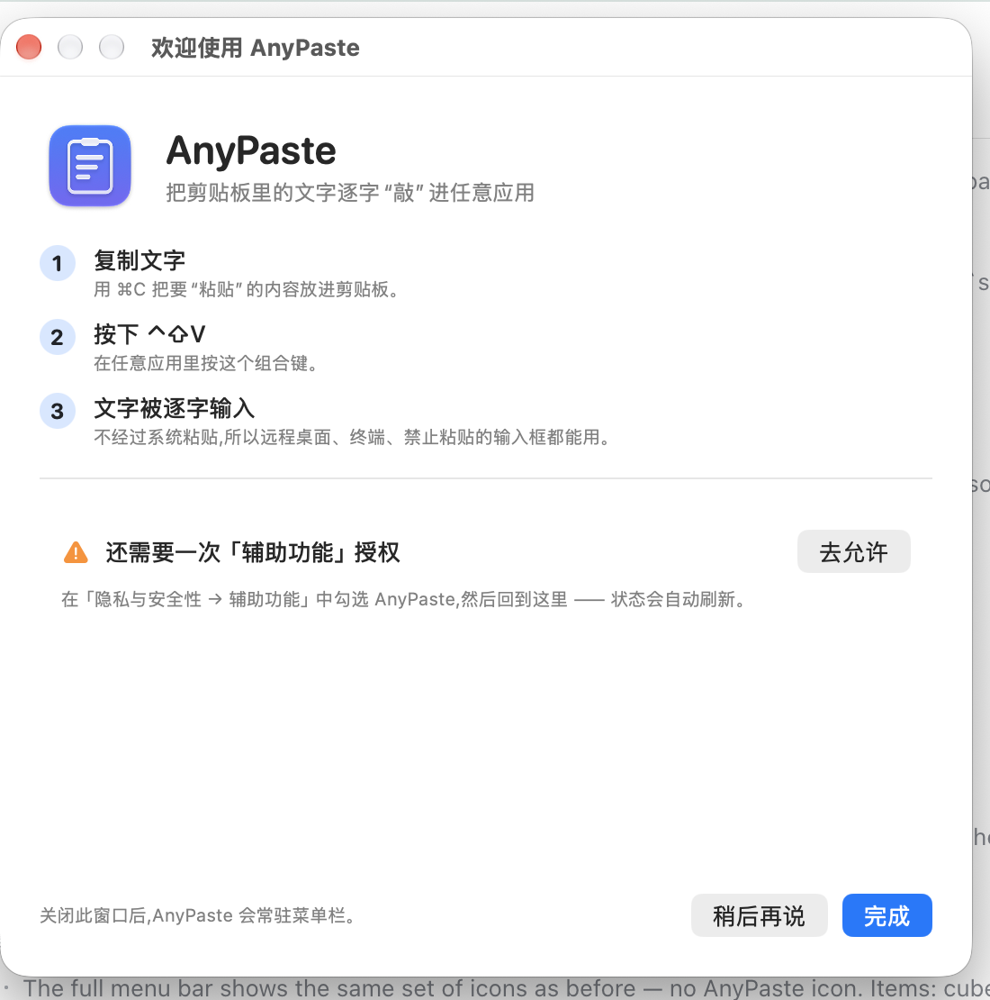

<div align="center">

# AnyPaste for macOS

**Type clipboard text into any app, character by character — not a system paste.**

[简体中文](README.md) · **English**

[](https://github.com/kaiwenyao/anypaste/releases) [](#compatibility-and-limitations) [](#compatibility-and-limitations) [](LICENSE)

macOS 13+ · Universal binary for Apple Silicon and Intel · No Apple Developer account required

[Install](#install) · [Usage](#usage) · [Features](#features) · [How it works](#how-it-works) · [FAQ](#faq) · [Development](#development) · [Background](#background)

</div>

AnyPaste does not use the system paste command. It sends real keyboard events to type the current clipboard text into the focused app, character by character. That makes it useful in remote desktops and VMs, terminals, paste-blocked input fields, and apps without a paste shortcut.

It does one thing: type the current clipboard text for you.

## Why AnyPaste?

| Scenario | System paste `⌘V` | AnyPaste `⌃⇧V` |
|---|---|---|
| Remote desktop / VM | May be blocked, delayed, or partial | Types character by character; delay is adjustable |
| Terminal / SSH / serial console | May be affected by paste protection or bracketed paste | Arrives as ordinary keystrokes |
| Paste-blocked input fields | Often does nothing | Usually works |
| Password fields / secure input | Blocked by macOS | Also blocked; the app explains why |

> Actual results depend on the target app and macOS version. AnyPaste cannot bypass system-level restrictions such as secure input.

**What it does not do**: no clipboard history, no clipboard sync, no images or files, and no clipboard-manager features.

## Install

### One-command install

```bash
curl -fL --proto '=https' --proto-redir '=https' \
  -o install-anypaste-macos.sh \
  https://github.com/kaiwenyao/anypaste/releases/latest/download/install-anypaste-macos.sh \
  && bash install-anypaste-macos.sh
```

The installer:

1. Downloads the universal binary and its SHA-256 checksum from the latest Release.
2. Verifies the checksum and app bundle; a failed check leaves the current install untouched.
3. Applies an **ad-hoc local signature** by default — no Apple Developer account and no keychain writes.
4. Quits the old instance and replaces `/Applications/AnyPaste.app`, falling back to `~/Applications` if needed; a failed replacement rolls back.
5. Removes the quarantine attribute, registers the app with LaunchServices, and launches it.

After the first launch, open **System Settings → Privacy & Security → Accessibility** and enable **AnyPaste**. macOS requires this for synthetic keystrokes; there is no way around it.

### Signing and updates

| Mode | What it provides | After an update |
|---|---|---|
| Default ad-hoc | No account, no password, no keychain; the ad-hoc signature is tied to the binary | macOS may ask you to re-enable Accessibility |
| `--sign local` | Creates a 10-year self-signed certificate and trusts it for code signing; asks for your login password once | The Accessibility grant can survive updates |

Repeat the same install command to update. With `--sign local`, the installer reuses the existing identity. If the certificate trust did not take effect, it falls back to ad-hoc and tells you.

### Common options

| Need | What to do |
|---|---|
| Keep Accessibility across updates | Add `--sign local` to the install command |
| Do not launch after installing | Add `--no-launch` to the install command |
| Install to a custom directory | Add `--prefix DIR` to the install command |
| Install from a local `.app` or `.zip` | Add `--app PATH` to the install command |
| English installer messages | Add `--lang en` to the install command |
| Uninstall | Add `--uninstall` to the install command |

Full options, signing details, and troubleshooting: [docs/INSTALL.md](docs/INSTALL.md) (currently in Chinese).

### Uninstall

If the installer script is still in the current directory:

```bash
bash install-anypaste-macos.sh --uninstall
```

Or from the source checkout:

```bash
bash Scripts/uninstall.sh
```

This removes the app, preferences, logs, `~/Library/Application Support/AnyPaste`, and the local signing keychain. If the script is gone, re-download it with the install command above and add `--uninstall`.

## Usage

1. Copy text with `⌘C`.
2. Switch to the target window and press **`⌃⇧V`**.
3. The text is typed character by character; press `Esc` to stop.

| Action | How |
|---|---|
| Type the clipboard | `⌃⇧V`, or menu bar icon → Type Clipboard Now |
| Stop typing | `Esc`, or menu bar → Stop Typing |
| Pause / resume the hotkey | Menu bar → Enable Hotkey |
| Open Settings | Menu bar icon → Settings… |
| Permissions and onboarding | Menu bar → Permissions & Onboarding… |
| Close the current window | `⌘W` while an AnyPaste window is focused; the app keeps running |
| Quit AnyPaste | `⌘Q` while an AnyPaste window is focused |

The app normally lives in the menu bar and has no Dock icon. Closing the current window (`⌘W`) does not quit AnyPaste; it keeps running in the menu bar. If macOS fails to present the menu bar item, AnyPaste automatically shows a Dock icon as a fallback; clicking that icon also opens Settings.

The hotkey, per-character delay (0–20 ms, default 1 ms), menu bar progress, and launch-at-login option are all in Settings. The default hotkey is `⌃⇧V`; record a different one on the Hotkey tab. If the combination is already taken, the app reports it immediately.

> The app UI is currently in Simplified Chinese; menu and settings labels in this README are translations.

### Screenshots

| Menu bar | Settings |
|---|---|
|  |  |

<p align="center">
  
</p>

<p align="center"><sub>Screenshots may show a version older than the latest release.</sub></p>

## Features

**Input**

- **Raw semantics**: `{}`, `^+!`, `%`, and similar characters are typed literally and never interpreted; newline = Return, Tab = Tab, and a backspace character is sent as Delete.
- **Real key codes + Unicode fallback**: characters the current keyboard layout can produce are sent with real key codes, which keeps input working in apps that only look at the virtual key code. Chinese, Japanese, Korean, emoji, and other characters the layout cannot produce are injected as Unicode.
- **Adjustable speed**: 0–20 ms per character (default 1 ms). Increase it when a remote desktop or Electron app drops characters.
- **Stop anytime**: `Esc` or the menu bar → Stop Typing; progress is shown in the menu bar by default.
- **Long text**: typed serially in the background with no hard length limit; the time depends on the text length and delay.
- **One job at a time**: triggering again while typing is ignored; nothing is queued or duplicated.

**Experience**

- Record a new global hotkey in Settings; conflicts are reported immediately.
- Menu bar first; if the system does not present the menu bar item, the app falls back to a Dock icon.
- Accessibility onboarding with live status; secure input (password fields) is reported instead of silently failing.
- Launch at login (`SMAppService`); keep the app in `/Applications`, otherwise macOS may report that the login item was not found.
- Built-in diagnostics: `--self-test` / `--e2e-test`, plus a one-click self-test and copyable report in Settings.

**Native**

- SwiftUI + AppKit, no third-party runtime dependencies; universal binary for Apple Silicon and Intel; macOS 13+.

## How it works

AnyPaste does not modify the pasteboard or invoke system paste. One typing run looks like this:

`⌃⇧V` → read clipboard text → plan characters and keystrokes → `CGEvent` → focused app

1. **Register the hotkey**: a global hotkey via Carbon's `RegisterEventHotKey`. Registering a hotkey does not require Accessibility; injecting keystrokes does.
2. **Read the text**: only plain text from `NSPasteboard.general` is read; images, files, and other non-text content are ignored.
3. **Plan the keystrokes**: the text is split by `Character` (grapheme cluster). Newline, Tab, space, and backspace map to fixed key codes. Characters the layout can produce are resolved to `(keyCode, shift)` with `UCKeyTranslate`; everything else becomes a pure Unicode event.
4. **Send the events**: `CGEvent` posts key-down/key-up events to `.cghidEventTap`. Each event carries at most 20 UTF-16 units, so long characters are chunked automatically.
5. **Run in the background**: typing runs on a serial queue and reports progress back on the main thread. `Esc` stops it through event monitors and a physical key-state poll.

## Compatibility and limitations

| Item | Details |
|---|---|
| OS | macOS 13 Ventura or later |
| Chip | Universal binary for Apple Silicon and Intel |
| Permission | Accessibility (required by macOS for synthetic keystrokes) |
| Clipboard | Plain text only; images and files are not typed; rich text is reduced to its text |
| Secure input | While any app has secure input enabled (for example, a password field), macOS ignores synthetic keystrokes; the app tells you |
| Concurrency | One typing job at a time; triggering again while typing is ignored |
| Length | No hard limit; time grows with text length and per-character delay |
| Launch at login | Uses `SMAppService`; keep the app in `/Applications` |

- **Accessibility cannot be bypassed.** This is a macOS system restriction; AnyPaste cannot work around it.
- **Some macOS 26/27 builds do not present new status items** (third-party menu bar apps have been observed to be affected as well). AnyPaste checks at 2, 5, 10, 20, 45, and 90 seconds after launch and again when the display configuration changes. It falls back to a Dock icon only when the item is confirmed not presented, and switches back when it detects recovery.
- **An ad-hoc update may require re-granting Accessibility.** Use `--sign local` if you want the grant to survive updates.
- **Text only.** Images, files, and rich-text formatting are not typed.

## Privacy and security

- **The app itself does not use the network**: no account, telemetry, auto-update, or upload logic. Only the installer downloads the release from GitHub.
- **During normal use, the clipboard is read only when you ask for typing**: on `⌃⇧V` or the "Type Clipboard Now" menu item. No history is saved and there is no background clipboard monitoring.
- **Logs do not contain clipboard text**: logs live at `~/Library/Logs/AnyPaste/anypaste.log`; during normal typing they record events such as launch, hotkey, permission, and character counts. Self-test records only clipboard types and length.
- **The installer is auditable**: it is plain Bash ([dist/install-anypaste-macos.sh](dist/install-anypaste-macos.sh)); downloads are verified against SHA-256 before unpacking.
- **No Apple notarization**: the default ad-hoc signature is why no developer account is needed; you still grant Accessibility manually on first run, and an update may require it again.

## FAQ

| Symptom | Fix |
|---|---|
| `⌃⇧V` does nothing | Check that AnyPaste is enabled in System Settings → Privacy & Security → Accessibility; Settings → Permissions & Diagnostics shows the live status |
| It is checked but the app still says it is not authorized | Quit and reopen AnyPaste first; if that fails, restart or log in again (some macOS versions apply permission changes late) |
| Characters are dropped or out of order | Raise the per-character delay to 5–10 ms (common with remote desktops and Electron apps) |
| Cannot type after an update | The ad-hoc signature changes with the binary; toggle AnyPaste off and on in Accessibility, or install with `--sign local` |
| No menu bar icon | A known problem on some macOS 26/27 builds; the app shows a Dock icon and switches back to the menu bar when it detects recovery |
| Nothing happens in a password field | The system has secure input enabled and ignores synthetic keystrokes; this is a macOS limitation |
| Hotkey conflict | Settings → Hotkey → record a new shortcut; the app reports conflicts |
| Clipboard contains an image or file | Only text is supported; nothing is typed and a HUD message is shown |
| Launch at login does not work | Move the app to `/Applications` and enable it again; Settings shows the login-item status |
| Report a problem | Open an [issue](https://github.com/kaiwenyao/anypaste/issues) with your macOS version, AnyPaste version, and `--self-test` output; do not paste clipboard contents |

More troubleshooting: [docs/INSTALL.md](docs/INSTALL.md) (currently in Chinese).

## Development

### Build from source

Requirements: macOS 13+, Xcode (from the App Store), and Python 3 (only when regenerating the project).

```bash
git clone https://github.com/kaiwenyao/anypaste.git
cd anypaste

bash Scripts/build.sh
open build/DerivedData/Build/Products/Release/AnyPaste.app

# Optional: install to /Applications
bash Scripts/install_local.sh
```

`Scripts/build.sh` builds the universal binary and applies an ad-hoc signature. `AnyPaste.xcodeproj` is generated by `Scripts/gen_project.py`; run it again after adding or removing Swift files:

```bash
python3 Scripts/gen_project.py
```

Maintainer release: `Scripts/release.sh <version>` (requires an authenticated `gh`).

### Verification

```bash
bash Scripts/verify.sh
```

By default this checks `/Applications/AnyPaste.app`; for a custom path:

```bash
APP_PATH="$PWD/build/DerivedData/Build/Products/Release/AnyPaste.app" bash Scripts/verify.sh
```

It checks the app bundle, signature, `Info.plist` contract, universal binary, `--self-test`, `--e2e-test`, a running process, and crash reports. `--e2e-test` briefly opens a test window and takes focus. `--self-test` can run without Accessibility by adding `--skip-accessibility-check`; `--e2e-test` also needs a real GUI session, so it is not suitable for headless CI.

Headless CI checks (build, generated-project freshness, bundle contract, menu/shortcut diagnostics):

```bash
bash Scripts/ci.sh
```

GitHub Actions runs the same script for pull requests and `main`.

See [docs/STAGING.md](docs/STAGING.md) for the staged window-close/quit change and handoff checklist.

### Project layout

| Path | Contents |
|---|---|
| `AnyPaste/App/` | `main.swift`, `AppDelegate.swift` (including `--self-test` / `--e2e-test`) |
| `AnyPaste/Core/` | Hotkey, keyboard layout, typing engine, permissions, preferences, diagnostics |
| `AnyPaste/UI/` | Menu bar, Settings, onboarding, HUD |
| `AnyPaste/Resources/` | App icon |
| `AnyPaste/Info.plist` | Bundle metadata, version, `LSUIElement` |
| `docs/` | Install notes, behavior spec, reverse-engineering report, screenshots |
| `analysis/` | Extracted original AHK script and sample SHA-256 |
| `Scripts/` | Build, project generation, local install, release, verification, uninstall |
| `dist/` | One-command install script |
| `AnyPaste.xcodeproj` | Generated by `Scripts/gen_project.py` |

## Background

The original Windows program `AnyPaste.exe` is not a native program. It is the **AutoHotkey v1.1.33.02 interpreter with a 49-byte script**:

```ahk
; <COMPILER: v1.1.33.02>
^+v::SendRaw %clipboard%
```

This repository is a native SwiftUI / AppKit rewrite that does not depend on AutoHotkey. The full evidence chain (PE structure, resources, import table, script bytes) is in [docs/REVERSE_ENGINEERING.md](docs/REVERSE_ENGINEERING.md), and the behavior mapping is in [docs/PORT_SPEC.md](docs/PORT_SPEC.md) (both currently in Chinese).

> The repository does not include `AnyPaste.exe` (it contains a third-party AutoHotkey binary). It keeps only the extracted 49-byte script and the [sample SHA-256](analysis/AnyPaste.exe.sha256).

## Feedback

Open an [issue](https://github.com/kaiwenyao/anypaste/issues) for bugs or suggestions. Including the following helps a lot:

- macOS version and chip (Apple Silicon / Intel)
- AnyPaste version (Settings → Permissions & Diagnostics)
- Output of `--self-test`

```bash
/Applications/AnyPaste.app/Contents/MacOS/AnyPaste --self-test
```

Please do not paste clipboard contents. Pull requests are welcome.

## License

Released under the [MIT](LICENSE) license.

The AutoHotkey interpreter inside the original `AnyPaste.exe` belongs to the AutoHotkey project (GPLv2); this repository no longer distributes that binary.
