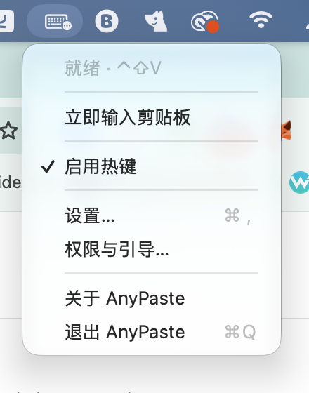
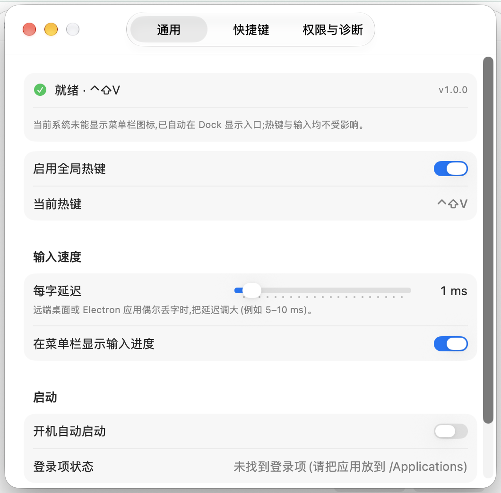
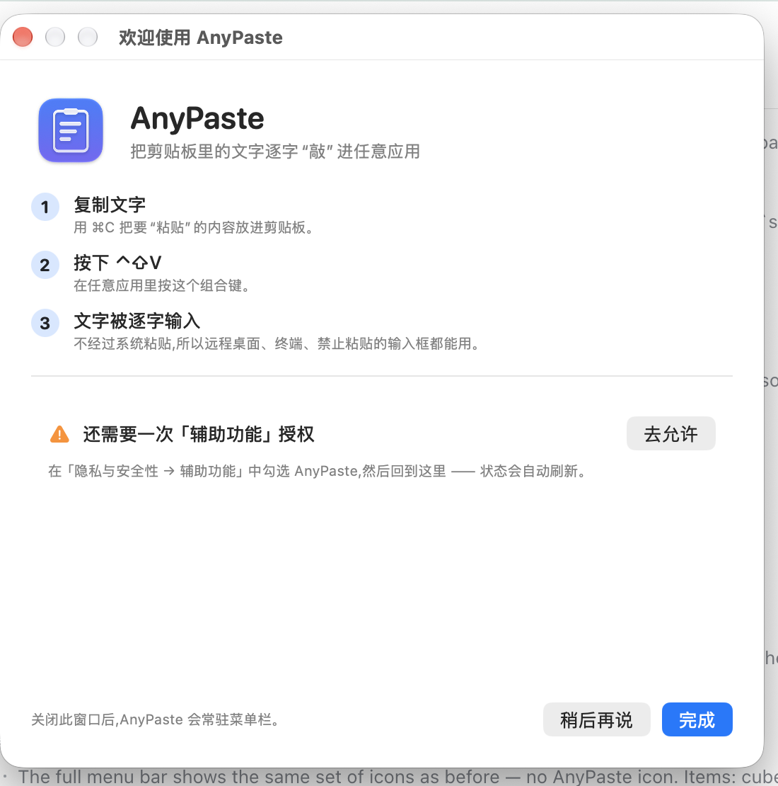

<div align="center">

# AnyPaste for macOS

把剪贴板里的文字<strong>逐字“敲”</strong>进任意应用 —— 不是系统粘贴。

**简体中文** · [English](README.en.md)

[](https://github.com/kaiwenyao/anypaste/releases) [](#兼容性与限制) [](#兼容性与限制) [](LICENSE)

macOS 13+ · Apple Silicon / Intel 通用二进制 · 无需 Apple 开发者账号

[安装](#安装) · [使用](#使用) · [功能](#功能) · [工作原理](#工作原理) · [常见问题](#常见问题) · [开发](#开发) · [逆向背景](#逆向背景)

</div>

AnyPaste 不调用系统粘贴，而是用真实键盘事件把剪贴板文本逐字符输入当前应用。因此在远程桌面 / 虚拟机、终端、禁止粘贴的输入框、没有粘贴快捷键的程序里也能工作。

它只做一件事：把当前剪贴板里的文本“敲”进去。

## 为什么需要它

| 场景 | 系统粘贴 `⌘V` | AnyPaste `⌃⇧V` |
|---|---|---|
| 远程桌面 / 虚拟机 | 可能被拦截、延迟，或只粘贴一部分 | 逐字输入，延迟可调 |
| 终端 / SSH / 串口 | 可能被粘贴保护或 bracketed paste 影响 | 作为普通按键输入 |
| 禁止粘贴的输入框 | 常常无反应 | 通常可以输入 |
| 密码框 / 安全输入 | 系统限制 | 系统同样限制，应用会提示 |

> 实际效果取决于目标应用和系统版本；AnyPaste 不能绕过 macOS 的安全输入等系统级限制。

**它不做什么**：不保存剪贴板历史、不同步剪贴板、不输入图片或文件、不替代剪贴板管理器。

## 安装

### 一键安装

```bash
curl -fL --proto '=https' --proto-redir '=https' \
  -o install-anypaste-macos.sh \
  https://github.com/kaiwenyao/anypaste/releases/latest/download/install-anypaste-macos.sh \
  && bash install-anypaste-macos.sh
```

安装器会：

1. 从最新 Release 下载通用二进制和 SHA-256 校验文件。
2. 校验 SHA-256 与应用包；校验失败时不会改动现有安装。
3. 在**登录钥匙串**中创建（或复用）一张 10 年期自签代码签名证书，并把它加入用户级 **code signing 信任**；然后用它重新签名下载的应用。无需 Apple 开发者账号。
4. 退出旧实例，替换 `/Applications/AnyPaste.app`；目录不可写时退回 `~/Applications`，替换失败自动回滚。
5. 清除 quarantine 属性、注册 LaunchServices，并启动应用。

首次安装时，macOS 可能请求一次钥匙串访问或信任确认；启动后还需在「系统设置 → 隐私与安全性 → 辅助功能」中勾选 **AnyPaste**。这两步只做一次。

**从 1.0.x（ad-hoc 签名）升级到 1.1.0 时，需要最后一次重新勾选辅助功能**：旧签名的 requirement 是随二进制变化的 cdhash，无法复用。从 1.1.0 起，后续升级会复用同一签名身份，不再要求重复授权。

### 签名方式与升级

| 方式 | 特点 | 升级后 |
|---|---|---|
| 默认（local） | 在登录钥匙串生成 10 年期自签证书并加入 code signing 信任；首次可能请求一次钥匙串/信任确认 | 复用同一身份，辅助功能授权跨版本保留 |
| `--sign adhoc` | 不写钥匙串；签名与具体二进制绑定 | 仅用于排查；每次升级后可能需要重新授权 |

重复执行同一条安装命令即可升级。安装器会复用已有签名身份，并在替换前用已保存的 designated requirement 校验新应用；如果身份丢失、信任被撤销或 requirement 不匹配，会中止安装（现有 app 不变），不会静默重建身份。需要主动重建时使用 `--reset-identity`（会要求重新授权一次）。

> 更新请使用安装器。不要直接把 Release 里 `AnyPaste-macos.zip` 的 app 拖进 `/Applications`：那会保留 ad-hoc 签名，失去持久身份。共享 Mac 上请用最初安装 AnyPaste 的系统用户执行更新。

### 常用选项

| 需求 | 做法 |
|---|---|
| 安装后不启动 | 在安装命令末尾加 `--no-launch` |
| 安装到指定目录 | 在安装命令末尾加 `--prefix DIR` |
| 用本地 `.app` 或 `.zip` 离线安装 | 在安装命令末尾加 `--app PATH` |
| 排查签名问题时临时改用 ad-hoc | 在安装命令末尾加 `--sign adhoc`（不保留授权） |
| 重建本地签名身份 | 在安装命令末尾加 `--reset-identity`（需要重新授权一次） |
| 英文提示 | 在安装命令末尾加 `--lang en` |
| 卸载 | 在安装命令末尾加 `--uninstall` |

完整参数、签名机制、恢复步骤和排错见 [docs/INSTALL.md](docs/INSTALL.md)。

### 卸载

如果安装脚本还在当前目录：

```bash
bash install-anypaste-macos.sh --uninstall
```

或从源码目录：

```bash
bash Scripts/uninstall.sh
```

会移除应用、偏好、日志、`~/Library/Application Support/AnyPaste` 和本地签名钥匙串。脚本不在时，用上面的安装命令重新下载，再加 `--uninstall`。

## 使用

1. 用 `⌘C` 复制要输入的文字。
2. 切到目标窗口，按 **`⌃⇧V`**。
3. 文字被逐字输入；输入过程中按 `Esc` 可中止。

| 操作 | 方式 |
|---|---|
| 输入剪贴板 | `⌃⇧V`，或菜单栏图标 → 立即输入剪贴板 |
| 中止输入 | `Esc`，或菜单栏 → 停止输入 |
| 暂停 / 恢复热键 | 菜单栏 → 启用热键 |
| 打开设置 | 菜单栏图标或 Dock 图标 → 设置… |
| 权限与引导 | 菜单栏 → 权限与引导… |
| 检查更新 | 设置 → 权限与诊断 → 检查更新 |
| 关闭当前窗口 | `⌘W`（AnyPaste 窗口聚焦时；应用继续运行） |
| 退出 AnyPaste | `⌘Q`（AnyPaste 窗口聚焦时） |

默认同时驻留菜单栏并显示 Dock 图标，点击 Dock 图标也能打开设置。关闭窗口（`⌘W`）不会退出应用；如果不想在 Dock 显示，可在 设置 → 通用 关闭「在 Dock 显示图标」，应用会只驻留菜单栏。系统不呈现菜单栏图标时，即使关闭了 Dock 图标，应用也会自动在 Dock 显示备用入口。

快捷键、每字延迟（0–20 ms，默认 5 ms）、菜单栏进度、Dock 图标、开机启动都在设置里调整。默认热键是 `⌃⇧V`，可在「快捷键」页录制修改；组合被占用时会立即提示。

### 界面

| 菜单栏 | 设置 |
|---|---|
|  |  |

<p align="center">
  
</p>

<p align="center"><sub>截图中的版本号可能早于最新 Release。</sub></p>

## 功能

**输入**

- **Raw 语义**：`{}`、`^+!`、`%` 等按字面输入，不会被解释；换行 = Return，Tab = Tab，退格字符 = Delete。
- **真实键码 + Unicode 回退**：当前键盘布局能产生的字符使用真实 key code，兼容只认虚拟键码的应用；中文、日文、韩文、emoji 等布局无法产生的字符走 Unicode 注入。
- **可控速度**：每字延迟 0–20 ms（默认 5 ms），远程桌面 / Electron 应用丢字时可调大。
- **随时中止**：`Esc` 或菜单「停止输入」；进度默认显示在菜单栏。
- **长文本**：后台串行输入，没有硬性长度上限；耗时随字符数和延迟增加。
- **一次一个任务**：输入过程中再次触发会被忽略，不会排队或重复输入。

**体验**

- 全局热键可在设置里录制修改；组合被占用会立即提示。
- 菜单栏常驻，默认同时显示 Dock 图标（可在设置关闭）；系统不呈现菜单栏图标时自动使用 Dock 图标作为备用入口。
- 辅助功能权限引导 + 实时状态；安全输入（密码框等）会明确提示，而不是静默失败。
- 开机自启（`SMAppService`）；建议把应用放在 `/Applications`，否则可能显示“未找到登录项”。
- 命令行提供 `--self-test` / `--e2e-test`；设置里也能运行自检并复制报告。
- 设置里可手动检查更新：发现新版本时显示 GitHub 入口，复制安装命令重跑即可升级；只比较发布版本号，不会自动下载或安装，也不会做后台轮询。

**原生**

- SwiftUI + AppKit，无第三方运行时依赖；通用二进制支持 Apple Silicon 与 Intel；macOS 13+。

## 工作原理

AnyPaste 不修改剪贴板，也不调用系统粘贴。一次输入的路径是：

`⌃⇧V` → 读取剪贴板文本 → 字符 / 按键规划 → `CGEvent` → 当前焦点应用

1. **注册热键**：使用 Carbon 的 `RegisterEventHotKey` 注册全局热键。注册本身不需要辅助功能权限，只有注入按键需要。
2. **读取文本**：只读取 `NSPasteboard.general` 的纯文本；图片、文件等非文本内容会被忽略。
3. **规划按键**：按 `Character`（字形簇）切分；换行、Tab、空格、退格映射到固定键码；布局能产生的字符用 `UCKeyTranslate` 反查当前键盘布局的 `(keyCode, shift)`；其余字符生成纯 Unicode 事件。
4. **发送事件**：用 `CGEvent` 向 `.cghidEventTap` 发送按下 / 抬起；每个事件最多携带 20 个 UTF-16 单元，超长字符自动分块。
5. **后台执行**：输入在串行队列中执行，进度回到主线程；`Esc` 通过事件监听和物理键态轮询中止。

## 兼容性与限制

| 项目 | 说明 |
|---|---|
| 系统 | macOS 13 Ventura 或更新 |
| 芯片 | Apple Silicon / Intel 通用二进制 |
| 权限 | 辅助功能（macOS 对模拟按键的硬性要求） |
| 剪贴板 | 仅纯文本；图片、文件不会输入；富文本只取文字 |
| 安全输入 | 当前有应用处于安全输入状态（如密码框）时，系统会忽略模拟按键，应用会提示 |
| 并发 | 一次只处理一个输入任务；输入中再次触发会被忽略 |
| 长度 | 无硬性上限；耗时随字符数和每字延迟增加 |
| 开机自启 | 使用 `SMAppService`；建议把应用放在 `/Applications` |

- **辅助功能权限无法绕过**。这是 macOS 对模拟按键的硬性要求。
- **部分 macOS 26/27 构建不呈现新建的菜单栏项**（第三方菜单栏应用也可能不显示）。AnyPaste 会在启动后 90 秒内及显示器配置变化时复查；确认未显示时启用 Dock 备用入口（已开启 Dock 图标时无需切换），检测到恢复后切回。
- **升级默认保留辅助功能授权**。首次使用需要信任本地签名证书并授予辅助功能各一次；之后安装器复用同一身份，升级不再重复。系统大版本升级、登录钥匙串被重置、换 macOS 用户更新或手动删除签名身份时，仍可能需要重新授权。
- **`--sign adhoc` 不保留授权**。它只用于排查签名问题；每次升级后 macOS 可能要求重新勾选。
- **仅文本**。图片、文件、剪贴板中的富文本格式不会被输入。

## 隐私与安全

- **应用不会自动联网**：没有账号、遥测、自动更新或上传逻辑。只有在你点击「检查更新」时，应用才会向 GitHub 的公开 API 查询最新 Release 版本号（不发送剪贴板内容或任何用户数据）；安装器从 GitHub 下载发布包。
- **正常使用时只在触发输入时读取剪贴板**：按 `⌃⇧V` 或点「立即输入剪贴板」时读取当前文本；不保存历史，不后台监听剪贴板。
- **日志不含剪贴板内容**：日志位于 `~/Library/Logs/AnyPaste/anypaste.log`；正常输入时只记录启动、热键、权限、字符数等事件，自检只记录剪贴板类型和长度。
- **本地签名身份**：安装器在登录钥匙串中创建 `AnyPaste Local Signing` 证书和私钥，私钥只授权 `/usr/bin/codesign` 使用；证书只在用户域的 code signing 策略下受信任，不会成为系统级根证书。卸载时一并删除。
- **安装器可审阅**：安装脚本是明文 Bash（[dist/install-anypaste-macos.sh](dist/install-anypaste-macos.sh)），下载后先校验 SHA-256 再解包。
- **未做 Apple 公证**：使用本机自签证书，不需要开发者账号，也不是 Developer ID 签名；首次运行仍要手动信任证书并授予辅助功能。

## 常见问题

| 现象 | 处理 |
|---|---|
| 按 `⌃⇧V` 没反应 | 检查「系统设置 → 隐私与安全性 → 辅助功能」是否勾选 AnyPaste；设置 → 权限与诊断 可看实时状态 |
| 已勾选但仍显示未授权 | 先退出并重新打开 AnyPaste；仍无效时重启或重新登录一次。若刚更新过版本，在辅助功能列表里用减号移除 AnyPaste，再重新添加并勾选 |
| 输入丢字 / 顺序不对 | 默认 5 ms；仍丢字时把每字延迟调到 10 ms 左右（远程桌面、Electron 应用常见） |
| 从旧版本更新后不能输入 | 从 ad-hoc 迁移到持久身份需要最后一次重新授权；之后升级会保留。若仍失效，确认是用安装器更新（不是手动拖拽 app），并运行 `AnyPaste --self-test` 查看 `axTrusted` |
| 安装时提示钥匙串访问 / 信任确认 | 这是首次创建本地签名身份所需，允许一次即可；以后升级会复用，不再提示。若拒绝，安装会中止且现有 app 不变 |
| 签名身份丢失或损坏 | 运行安装器并加 `--reset-identity` 重建身份；这会要求重新授权一次辅助功能。若能恢复原证书/私钥，优先恢复以保留授权 |
| 菜单栏看不到图标 | 部分 macOS 26/27 构建的系统问题；默认 Dock 图标仍可在 Dock 打开设置。若关闭了 Dock 图标，应用会自动启用备用入口，检测到恢复后切回菜单栏 |
| 密码框里没有反应 | 系统处于安全输入状态，模拟按键会被忽略；这是 macOS 的限制 |
| 快捷键冲突 | 设置 → 快捷键 → 录制新快捷键；被占用时应用会提示 |
| 剪贴板是图片 / 文件 | 只支持文本；图片、文件不会输入，屏幕会提示 |
| 开机自启不可用 | 把应用放到 `/Applications` 后再开启；设置里会显示登录项状态 |
| 想反馈问题 | 开 [Issue](https://github.com/kaiwenyao/anypaste/issues)，附上 macOS 版本、AnyPaste 版本和 `--self-test` 输出；不要粘贴剪贴板内容 |

更多排错见 [docs/INSTALL.md](docs/INSTALL.md)。

## 开发

### 从源码构建

要求：macOS 13+、Xcode（从 App Store 安装）、Python 3（仅在重新生成工程时需要）。

```bash
git clone https://github.com/kaiwenyao/anypaste.git
cd anypaste

bash Scripts/build.sh
open build/DerivedData/Build/Products/Release/AnyPaste.app

# 可选：安装到 /Applications
bash Scripts/install_local.sh
```

`Scripts/build.sh` 会生成通用二进制并做 ad-hoc 签名(发布包需要由用户安装器用其本地身份重签)。`AnyPaste.xcodeproj` 由 `Scripts/gen_project.py` 生成；新增或删除 Swift 文件后重新运行：

```bash
python3 Scripts/gen_project.py
```

开发时如果要保留辅助功能授权，请用 `Scripts/install_local.sh` 安装(它会走安装器并复用持久身份)；直接打开 `build/` 下的 app 仍是 ad-hoc 签名，重新构建后需要重新授权。

维护者发布：先把 `AnyPaste/Info.plist` 的 `CFBundleShortVersionString` / `CFBundleVersion` 改成新版本和构建号，运行 `python3 Scripts/gen_project.py`，再执行 `Scripts/release.sh <version>`（需要已登录的 `gh`）。发布脚本会校验 tag 与应用版本一致。

### 版本号

设置 → 权限与诊断显示 `v1.1.0 (9)`：

- `1.1.0` 是**发布版本号**（`CFBundleShortVersionString`），对应 GitHub Release 的 tag（`v1.1.0`）；检查更新只比较它。
- `(9)` 是**构建号**（`CFBundleVersion`），每次打包递增，用来区分同一发布版本的不同构建。

发布新版本时两个值一起递增，再按上面的步骤重新生成工程并发布。

### 验收

```bash
bash Scripts/verify.sh
```

默认检查 `/Applications/AnyPaste.app`；自定义路径：

```bash
APP_PATH="$PWD/build/DerivedData/Build/Products/Release/AnyPaste.app" bash Scripts/verify.sh
```

会检查应用包、签名、`Info.plist` 契约、通用二进制、`--self-test`、`--e2e-test`、进程存活、Dock 图标（默认开启时）和崩溃报告。`--e2e-test` 会短暂弹出测试窗口并获取焦点；`--self-test` 可用 `--skip-accessibility-check` 在无辅助功能权限的无头环境运行，`--e2e-test` 还依赖真实 GUI 会话，因此不适合无头 CI。

无头 CI 检查（构建、工程文件同步、bundle 契约、菜单快捷键诊断）：

```bash
bash Scripts/ci.sh
```

GitHub Actions 会在 PR 和 `main` 分支上运行同一脚本。

### 目录结构

| 路径 | 内容 |
|---|---|
| `AnyPaste/App/` | `main.swift`、`AppDelegate.swift`（含 `--self-test` / `--e2e-test`） |
| `AnyPaste/Core/` | 热键、键盘布局、输入引擎、权限、偏好、诊断、检查更新 |
| `AnyPaste/UI/` | 菜单栏、设置、首次引导、HUD |
| `AnyPaste/Resources/` | 应用图标 |
| `AnyPaste/Info.plist` | Bundle 元数据、版本、`LSUIElement`（菜单栏代理；Dock 图标由运行时策略控制） |
| `docs/` | 安装说明、行为规格、逆向报告、截图 |
| `analysis/` | 提取出的原 AHK 脚本与样本 SHA-256 |
| `Scripts/` | 构建、工程生成、本地安装、发布、验收、卸载 |
| `dist/` | 一键安装脚本 |
| `AnyPaste.xcodeproj` | 由 `Scripts/gen_project.py` 生成 |

## 逆向背景

Windows 原程序 `AnyPaste.exe` 不是原生程序，而是 **AutoHotkey v1.1.33.02 解释器 + 一条 49 字节脚本**：

```ahk
; <COMPILER: v1.1.33.02>
^+v::SendRaw %clipboard%
```

本仓库用 SwiftUI / AppKit 原生重写，不依赖 AutoHotkey。完整证据链（PE 结构、资源、导入表、脚本字节）见 [docs/REVERSE_ENGINEERING.md](docs/REVERSE_ENGINEERING.md)，行为映射见 [docs/PORT_SPEC.md](docs/PORT_SPEC.md)。

> 仓库不包含 `AnyPaste.exe`（其中含第三方 AutoHotkey 二进制），只保留提取出的 49 字节脚本和[样本 SHA-256](analysis/AnyPaste.exe.sha256)。

## 反馈

有问题或建议请开 [Issue](https://github.com/kaiwenyao/anypaste/issues)。提供以下信息能更快定位：

- macOS 版本与芯片（Apple Silicon / Intel）
- AnyPaste 版本（设置 → 权限与诊断）
- `--self-test` 的输出

```bash
/Applications/AnyPaste.app/Contents/MacOS/AnyPaste --self-test
```

请勿粘贴剪贴板内容。欢迎 Pull Request。

## License

本项目以 [MIT](LICENSE) 许可发布。

原 `AnyPaste.exe` 中的 AutoHotkey 解释器属于 AutoHotkey 项目（GPLv2）；本仓库不再分发该二进制。
